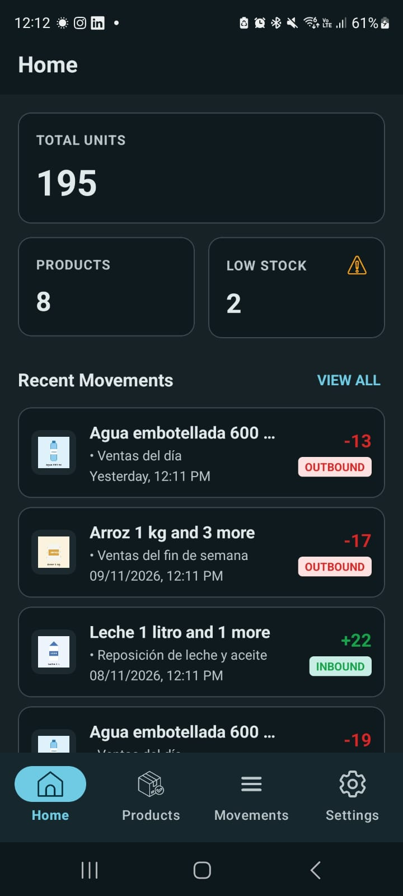
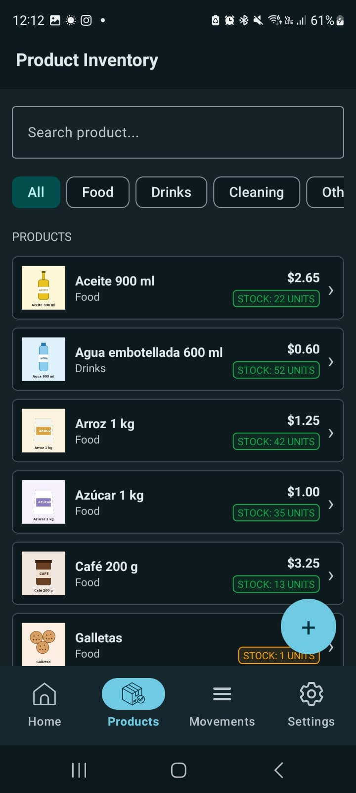
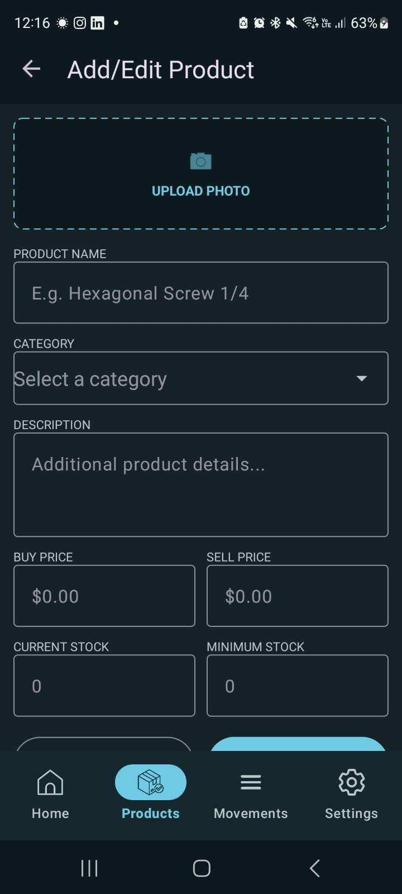
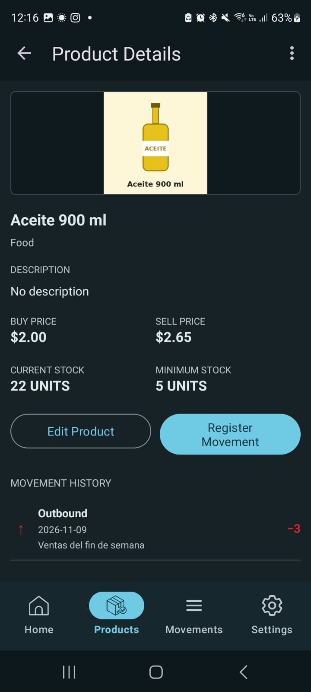
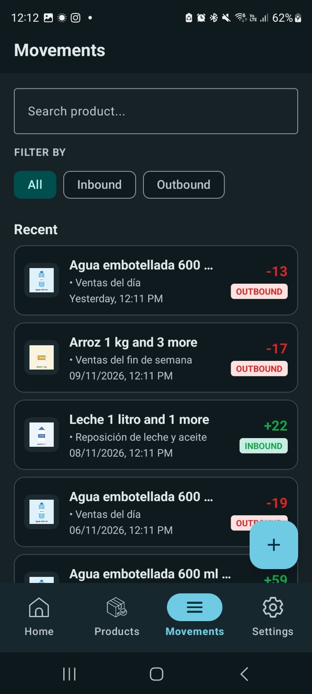
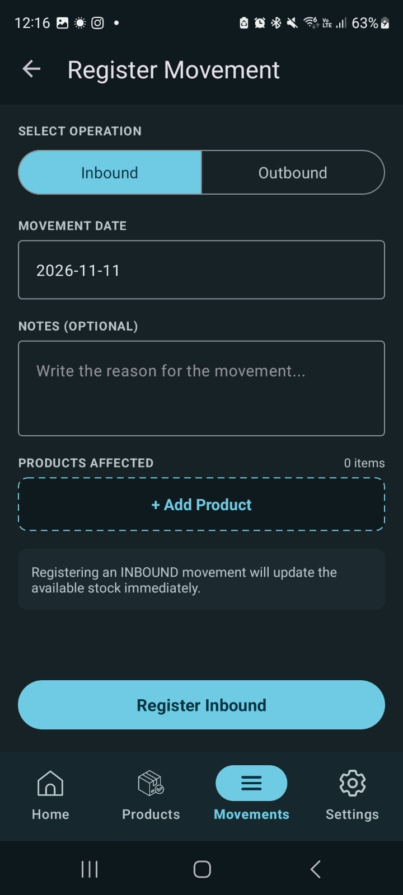
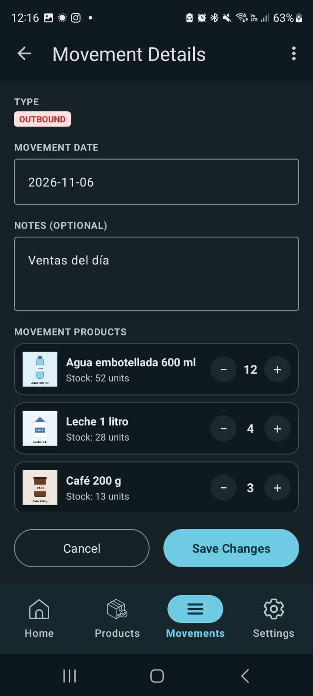
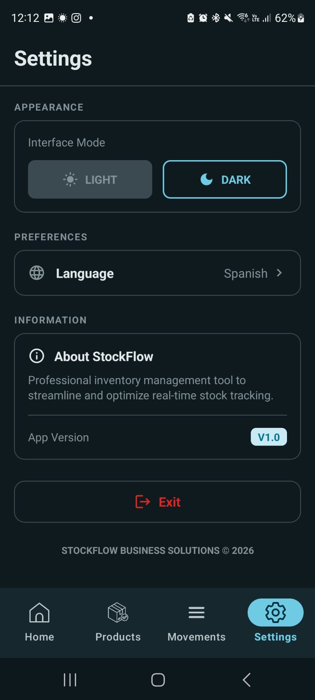
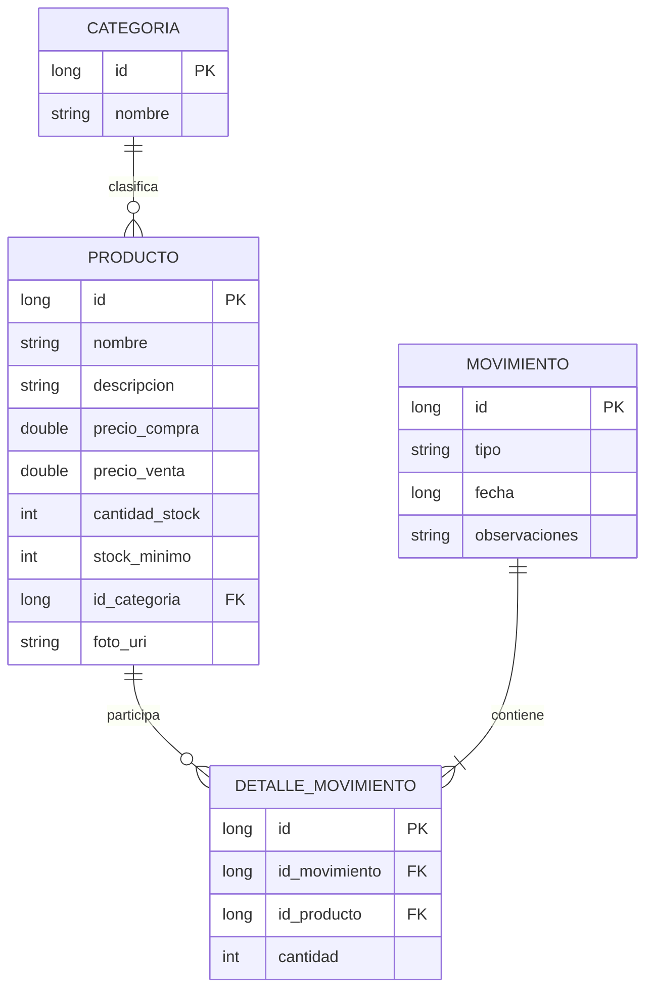

# 📦 StockFlow

**Aplicación Android para la gestión y el control de inventario de pequeños negocios.**

<p align="center">
  
  
  
  
  
</p>

---

## 📖 Descripción

**StockFlow** es una aplicación móvil desarrollada para facilitar la administración de inventarios en pequeños negocios. Permite gestionar productos, controlar existencias, registrar entradas y salidas de mercancía y recibir alertas cuando un producto alcanza su nivel mínimo de inventario.

La aplicación utiliza una base de datos local para almacenar la información directamente en el dispositivo, permitiendo trabajar sin conexión a Internet y sin necesidad de crear una cuenta.

El proyecto fue desarrollado como parte de la asignatura **Desarrollo Móvil 1**, de la carrera de Ingeniería en Sistemas Informáticos, mediante el trabajo colaborativo de un equipo de cuatro estudiantes.

### Características principales

- Funcionamiento local, sin necesidad de conexión a Internet.
- Almacenamiento persistente mediante Room y SQLite.
- Control de inventario mediante entradas y salidas de productos.
- Notificaciones para alertar sobre niveles bajos de existencias.

## ✨ Funcionalidades

| Módulo | Descripción |
|---|---|
| **Inicio (Dashboard)** | Resumen del inventario, total de productos, unidades disponibles, productos con stock bajo y movimientos recientes. |
| **Gestión de productos** | Registrar, consultar, editar y eliminar productos, incluyendo descripción, precios, fotografía y categoría. |
| **Control de existencias** | Definir cantidades disponibles y establecer un stock mínimo para cada producto. |
| **Alertas de inventario** | Identificar visualmente los productos con stock bajo y recibir notificaciones cuando alcanzan o están por debajo del mínimo establecido. |
| **Movimientos** | Registrar entradas y salidas de inventario, incluyendo varios productos en una misma operación. |
| **Historial de movimientos** | Consultar, buscar y filtrar movimientos por tipo, además de visualizar sus respectivos detalles. |
| **Historial por producto** | Consultar los movimientos asociados a cada producto. |
| **Configuración** | Personalizar la aplicación mediante el modo claro u oscuro y la selección de idioma español o inglés. |

### 🔔 Sistema de alertas

StockFlow incorpora un sistema de notificaciones para facilitar el seguimiento de las existencias.

- Detecta cuando la cantidad disponible de un producto es menor o igual a su stock mínimo.
- Genera una notificación cuando se alcanza esa condición.
- Evita repetir la notificación mientras el producto permanezca con stock bajo.
- Permite generar una nueva alerta cuando el inventario se recupera y posteriormente vuelve a alcanzar el mínimo.

## 📱 Capturas de pantalla

Las siguientes imágenes muestran las principales pantallas de la aplicación.

| Inicio | Productos | Formulario de producto | Detalle del producto |
|---|---|---|---|
|  |  |  |  |

| Movimientos | Registrar movimiento | Detalle del movimiento | Configuración |
|---|---|---|---|
|  |  |  |  |


## 🛠️ Tecnologías utilizadas

| Tecnología | Uso |
|---|---|
| **Kotlin** | Lenguaje principal de desarrollo. |
| **Android SDK** | Plataforma de desarrollo de la aplicación. |
| **XML** | Diseño de interfaces. |
| **ViewBinding** | Acceso seguro a las vistas. |
| **Material Design 3** | Componentes y estilos de interfaz. |
| **Room** | Persistencia y administración de la base de datos local. |
| **SQLite** | Motor de almacenamiento de datos. |
| **ViewModel** | Administración de los datos y estado de las pantallas. |
| **Kotlin Coroutines** | Ejecución de operaciones asíncronas. |
| **Flow** | Observación y emisión de cambios en los datos. |
| **Navigation Component** | Navegación entre pantallas. |
| **Gradle** | Sistema de construcción del proyecto. |
| **Git y GitHub** | Control de versiones y colaboración. |

### Configuración de Android

- **Minimum SDK:** API 24 (Android 7.0).
- **Compile SDK:** 37.
- **Target SDK:** 37.

## 🏗️ Arquitectura y estructura del proyecto

StockFlow utiliza una estructura basada en una única `Activity`, múltiples `Fragments` y el patrón **MVVM (Model-View-ViewModel)** para organizar la lógica y la presentación.

### Estructura general

```text
app/src/main/java/com/leon/stockflow/
│
├── MainActivity.kt
│
├── data/
│   ├── AppDatabase.kt
│   ├── entity/
│   ├── dao/
│   └── model/
│
└── ui/
    ├── common/
    ├── home/
    ├── products/
    ├── movements/
    └── settings/
```

```text
app/src/main/res/
│
├── layout/
├── navigation/
│   └── nav_graph.xml
├── values/
└── values-en/
```

### Flujo de datos

La información se obtiene y actualiza mediante los siguientes componentes:

```text
Room / SQLite
      ↓
     DAO
      ↓
  ViewModel
      ↓
   Fragment
      ↓
  Interfaz de usuario
```

- **Data:** contiene la base de datos, entidades, consultas y modelos.
- **UI:** agrupa las pantallas y sus componentes.
- **ViewModel:** administra la información que consumen las interfaces.
- **DAO:** define las operaciones de acceso a la base de datos.

## 🗄️ Modelo de base de datos

La persistencia de información se implementa mediante **Room**, utilizando SQLite como base de datos local.

El modelo de datos contempla las siguientes entidades:



### Consideraciones del inventario

- Un movimiento puede contener varios productos.
- Cada detalle de movimiento relaciona un producto con su respectivo movimiento.
- Las entradas incrementan las existencias y las salidas las disminuyen.
- Las operaciones de registro de movimientos se realizan mediante transacciones para mantener la consistencia de los datos.
- No se permiten salidas que superen las existencias disponibles.
- El inventario no puede quedar con cantidades negativas.

## 🎨 Diseño de interfaz

La interfaz fue diseñada en **Figma** e implementada utilizando componentes de Material Design 3.

La aplicación incluye:

- Tema claro y oscuro.
- Idioma español e inglés.
- Navegación mediante barra inferior.
- Componentes visuales para identificar el estado del inventario.
- Formularios para la administración de productos y movimientos.

## 🚀 Instalación y ejecución

### Requisitos

- Android Studio compatible con la versión de Android Gradle Plugin utilizada por el proyecto.
- JDK compatible con la configuración de Gradle.
- Android SDK correspondiente al proyecto.
- Emulador o dispositivo físico con Android 7.0 (API 24) o superior.

### Clonar el repositorio

```bash
git clone https://github.com/USUARIO/REPOSITORIO.git
```

### Ejecutar la aplicación

1. Abre el proyecto desde Android Studio.
2. Espera a que finalice la sincronización de Gradle.
3. Selecciona un emulador o conecta un dispositivo Android.
4. Ejecuta la aplicación mediante **Run ▶**.

> La aplicación no necesita conexión a Internet para utilizar sus funciones de inventario. Sin embargo, Android Studio necesita acceso a Internet para descargar las dependencias del proyecto cuando sea necesario.

## 🌿 Control de versiones

Durante el desarrollo se utilizó Git y GitHub para administrar el código fuente y facilitar el trabajo colaborativo.

Se utilizaron ramas para organizar el desarrollo de funcionalidades e integrar los cambios del equipo.

## 👥 Equipo de desarrollo

Proyecto desarrollado colaborativamente por cuatro estudiantes.

| Integrante | Responsabilidad |
|---|---|
| Douglas Eduardo Leon Vega | Configuración inicial, arquitectura del proyecto, estructura de carpetas, configuración de Room parcial, navegación, integración de módulos y resolución de errores. |
| Luis Daniel Barrera Escobar | Desarrollo del módulo de movimientos, configuración de Room parcial, navegación preliminar. |
| Douglas David Moran Ordoñez | Desarrollo del módulo de configuraciones. |
| Carlos Misael López Varillas | Desarrollo del módulo de productos. |

**Información académica**

- **Asignatura:** Desarrollo Móvil 1.
- **Carrera:** Ingeniería en Sistemas Informáticos.
- **Universidad:** Universidad Catolica de El Salvador.
- **Docente:** Ing. Paolo Isaac Navarro Rosales.
- **2do Ciclo académico:** 2026.

## 📄 Licencia

Proyecto académico desarrollado con fines educativos.
